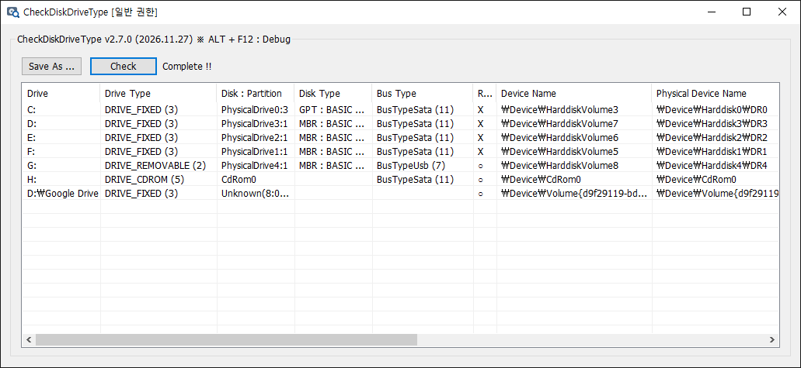

# CheckDiskDriveType

Windows 에 연결된 드라이브의 **드라이브 종류, 물리 디스크와 파티션 번호, 기본/동적 디스크, 버스 타입,
이동식 여부, 장치 이름, 볼륨 GUID, 디스크 크기, 제조사·모델·시리얼 번호**를 한 화면의 표로 보여주는 진단 도구입니다.

[English](#english)

## 다운로드

[Releases](../../releases/latest) 에서 `CheckDiskDriveType_vX.Y.Z.W.zip` 을 내려받아 압축을 풉니다.

- 설치 없이 `CheckDiskDriveType.exe` 를 바로 실행하면 됩니다.
- 디지털 서명된 파일입니다. 파일 속성의 **디지털 서명** 탭에서 서명자와 타임스탬프를 확인할 수 있습니다.

## 실행 환경

- Windows Vista 이상 (Windows 7 / 10 / 11, Windows Server 포함)

## 사용법

1. `CheckDiskDriveType.exe` 를 실행합니다.
2. **Check** 를 누르면 A: ~ Z: 드라이브와 폴더에 마운트된 볼륨(예: 구글 드라이브)을 조회해 표에 표시합니다.
3. **Save As ...** 로 결과를 텍스트 파일로 저장합니다.
4. **ALT + F12** 를 누르면 디버그 콘솔이 열려 조회 과정의 상세 로그를 볼 수 있습니다. 다시 누르면 닫힙니다.

## 표시 항목

| 컬럼 | 내용 |
|---|---|
| Drive | 드라이브 문자, 또는 폴더 마운트 경로 (예: `D:\Google Drive`) |
| Drive Type | `DRIVE_FIXED`, `DRIVE_REMOVABLE`, `DRIVE_CDROM`, `DRIVE_REMOTE` 등 |
| Disk : Partition | 볼륨이 있는 물리 디스크와 파티션 번호 (예: `PhysicalDrive0:3`) |
| Disk Type | 파티션 스타일과 기본/동적 디스크 (예: `GPT : BASIC`, `MBR : DYNAMIC`, `RAW`) |
| Bus Type | 연결 버스 (예: `BusTypeSata`, `BusTypeNvme`, `BusTypeUsb`) |
| Removable | 이동식(핫플러그) 장치이면 `○`, 아니면 `X` |
| Device Name | 볼륨 장치 이름 (예: `\Device\HarddiskVolume3`) |
| Physical Device Name | 물리 장치 이름 (예: `\Device\Harddisk0\DR0`) |
| Volume Name (GUID) | 볼륨 GUID 경로 |
| Disk Size (Free / Total) | 남은 용량 / 전체 용량 |
| Vendor / Product / Serial Number | 장치가 제공하는 제조사, 모델, 시리얼 번호 |

장치나 드라이버가 정보를 제공하지 않는 항목은 빈칸으로 표시됩니다.

## 라이선스

개인·기업·기관 누구나 **무료로 사용**할 수 있습니다. 단, **재배포는 허용하지 않습니다.**
다른 사람과 공유할 때는 이 페이지의 링크를 알려 주십시오. 수정, 역설계, 판매는 금지되며 무보증으로 제공됩니다.
자세한 조건은 [LICENSE](LICENSE) 를 참고하십시오.

---

## English

**CheckDiskDriveType** is a Windows diagnostic tool that shows, in a single table, the **drive type,
physical disk and partition number, basic/dynamic disk, bus type, removable flag, device names,
volume GUID, disk size, and vendor, product and serial number** of each connected drive.

### Download

Download `CheckDiskDriveType_vX.Y.Z.W.zip` from [Releases](../../releases/latest) and extract it.

- No installation is needed. Just run `CheckDiskDriveType.exe`.
- The file is digitally signed. You can check the signer and timestamp on the **Digital Signatures** tab of the file properties.

### Requirements

- Windows Vista or later (including Windows 7 / 10 / 11 and Windows Server)

### Usage

1. Run `CheckDiskDriveType.exe`.
2. Click **Check** to scan drives A: to Z: and volumes mounted in folders (e.g. Google Drive), and list them in the table.
3. Click **Save As ...** to save the result as a text file.
4. Press **ALT + F12** to open a debug console with detailed logs of the scan. Press it again to close it.

### Columns

| Column | Description |
|---|---|
| Drive | Drive letter, or folder mount path (e.g. `D:\Google Drive`) |
| Drive Type | `DRIVE_FIXED`, `DRIVE_REMOVABLE`, `DRIVE_CDROM`, `DRIVE_REMOTE`, etc. |
| Disk : Partition | Physical disk and partition number of the volume (e.g. `PhysicalDrive0:3`) |
| Disk Type | Partition style and basic/dynamic disk (e.g. `GPT : BASIC`, `MBR : DYNAMIC`, `RAW`) |
| Bus Type | Connection bus (e.g. `BusTypeSata`, `BusTypeNvme`, `BusTypeUsb`) |
| Removable | `○` for a removable (hot-pluggable) device, otherwise `X` |
| Device Name | Volume device name (e.g. `\Device\HarddiskVolume3`) |
| Physical Device Name | Physical device name (e.g. `\Device\Harddisk0\DR0`) |
| Volume Name (GUID) | Volume GUID path |
| Disk Size (Free / Total) | Free space / total size |
| Vendor / Product / Serial Number | Vendor, model and serial number reported by the device |

Values that the device or driver does not report are left blank.

### License

Free to use for anyone, including individuals, companies and organizations. **Redistribution is not permitted.**
To share it, please share a link to this page instead. Modification, reverse engineering and resale are prohibited,
and the software is provided without warranty. See [LICENSE](LICENSE) for the full terms.

---

Copyright (c) 2026, Innotena
